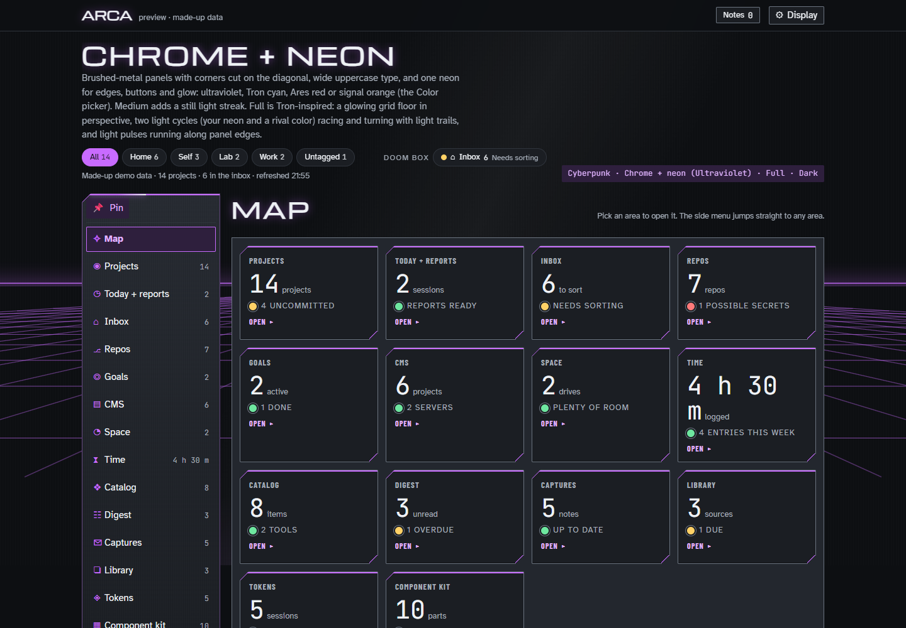

# ARCA

**Accumulate, Rummage, Classify, Act**

ARCA is a dashboard for keeping track of every project folder I work in: where each one lives, its repo, docs, status, next step and time logged. It also plans the day, collects stray thoughts in an inbox to sort later, keeps a catalog of useful links and tools, and links projects to Jira codes and goals.

**[Take the click-through tour](https://hyunjee-hale.github.io/arca/)** · **[See every look](https://hyunjee-hale.github.io/arca/themes.html)**

*The Map, in the Cyberpunk theme's Chrome + neon style. Every section is a card with its count and status. All data shown is made up.*

## The name

*Arca* is Latin for a chest or strongbox, and the root of "archive". The name is also the workflow for anything that lands in it:

| | |
|---|---|
| **Accumulate** | It lands in the box as it is, with no sorting at capture time |
| **Rummage** | It comes back up later, during a review or a random pull |
| **Classify** | It gets tagged or linked to a project |
| **Act** | It becomes a task or a project, or gets parked or tossed |

## What's in it

- **Map:** every section as a card with its count and status, and a side menu that jumps to any of them. A "doom box" keeps up to three sections you're watching beside the category buttons.
- **Projects:** each project folder with its status, next step, to-dos, log, links, repo state and time logged.
- **Today:** the day's work sessions, and Plan My Day for picking today's tasks and carrying unfinished ones forward.
- **Inbox:** stray thoughts dropped in without deciding where they go, sorted later into to-dos, notes, goals or the catalog.
- **Repos:** every git repo with its branch, changes, ahead/behind and flags such as files that look like secrets.
- **Goals, Time and Catalog:** what you're aiming for, time logged against projects and work codes, and links and tools worth finding again.
- **CMS, Space, Digest, Captures, Library and Tokens:** projects on content management servers, disk space, mail and calendar, notes from a phone, sources you follow, and AI session usage.
- **Layouts and looks:** Grid, Map or Classic layout, in three themes (Space, Cyberpunk, Goth) with four styles each, light or dark, from subtle to fully animated.

## What's in this repo

This repo is a preview, not the tool. The code isn't shared yet; architecture notes and diagrams will follow.

- **[The tour](https://hyunjee-hale.github.io/arca/)** starts at the Map, then follows its sections in order, and ends with the layout switcher and the classic layout. Each screen's panels and main features are numbered: click a number, type it, or pick it from the list above the screen to see what that part does and what it shows. Parts that lead to another screen have a "Go to" button. The arrow keys move between screens.
- **[The looks page](https://hyunjee-hale.github.io/arca/themes.html)** shows all 12 styles, dark, light and moving.

Everything in the screenshots is made up: the projects, paths, numbers, mail and servers.

## Status

Work in progress.
